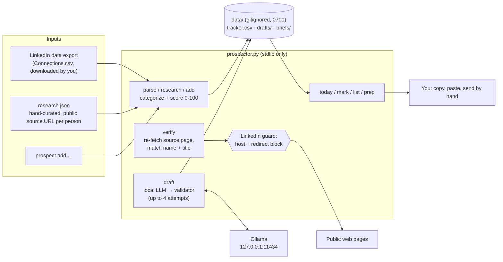

# UAE Prospector

[](https://github.com/Rudra-C-Patel/uae-prospector/actions/workflows/ci.yml)


**A local CLI that finds and scores automotive decision-makers from public sources, drafts LinkedIn messages on a local LLM behind a rule-based validator, and tracks each conversation. You send every message by hand; the tool never touches LinkedIn.**

## Why it exists

I was doing founder-led sales for [DealerScope](https://github.com/Rudra-C-Patel/dealerscope-ai) in the UAE car market from California, with no budget and no network there. I needed a short daily list of the right people, a first message that didn't sound like spam, and a record of who said what. I also didn't want to risk my LinkedIn account on automation or invent facts about strangers. So the tool does the research, ranking and drafting, and I do the sending.

## Architecture



## Features

- **Scoring (0–100).** The base comes from the category (automotive 45, investor/ecosystem 30, other 10). Add the single best title boost out of 7 tiers (dealer principal/GM, aftersales and CRM/CX buyers +35; CEO/MD/founder +30; down to manager +8). There's +10 for a UAE company and +5 for one of 31 known UAE dealer groups. Sources more than a year old lose 10.
- **LinkedIn export import.** It reads the newest `Connections.csv` export, skips LinkedIn's "Notes:" preamble, and keeps people whose company looks UAE-based. The export has no location column, so this is inferred.
- **Source verification.** `verify` re-fetches each public source page and grades it: `yes` (full name with the exact title right beside it), `likely` (title words nearby), `partial`, `no` or `unreachable`.
- **Generate → validate → retry.** The local model drafts a connection note (≤280 chars) and a follow-up DM. A validator checks length, 25 banned patterns (percentages, "guarantee", hype words, `!`, fake familiarity like "I've been following your work"), required content (the core idea, a 20-minute ask, the 8–11 AM UAE window, the pilot) and a grammar rule. Failures go back to the model as feedback, with the temperature rising on each of up to 4 attempts. Anything still failing is flagged `CHECK:`.
- **Daily cap.** `today` shows at most `15 − (marked sent today)` people. `mark … sent` warns past 15.
- **Coffee-chat briefs.** `prep` writes a one-page brief. Facts come from the source; likely pains are explicitly labelled hypotheses to test.

## Privacy and safety design

| Rule | Enforced by |
|---|---|
| **LinkedIn is never automated** | `is_blocked()` rejects `linkedin.com`, `lnkd.in` and `licdn.com` (and their subdomains) before any request, and a custom redirect handler refuses redirects to them. The only LinkedIn artifact is a plain people-search URL for you to open yourself. |
| **Nothing is ever sent** | There's no send code path. Drafts are printed and saved locally, and you copy and paste them. |
| **Local LLM only** | Drafts and briefs come from Ollama at `127.0.0.1:11434`. Override the model with `PROSPECT_MODEL`. |
| **No invented people** | `research` and `add` refuse anyone without a public source URL, and `verify` re-checks the page. |
| **Data stays local** | `data/` is `chmod 700`, its files are `600`, and it's gitignored along with any CSV/ZIP export. |
| **No dependencies** | Python standard library only. Nothing to install, nothing paid. |

## Setup

```bash
git clone https://github.com/Rudra-C-Patel/uae-prospector ~/uae-prospector
alias prospect=~/uae-prospector/prospect     # runs prospector.py with python3 -I
ollama pull <your-model> && export PROSPECT_MODEL=<your-model>
```

## Usage

```bash
prospect parse [zip]                       # import UAE people from your LinkedIn Connections export
prospect research [json]                   # import researched public-source people (data/research.json)
prospect add "Name" "Title" "Company" "City" "https://source" "why" ["detail"]
prospect verify --all                      # re-check each source page shows the name + title
prospect draft --all                       # note + follow-up DM on the local model
prospect today                             # top 10 to send, with note, source and search link
prospect mark "Name" sent | accepted | "chat booked" | pilot | no  [--note "..."]
prospect prep "Name"                       # coffee-chat brief → data/briefs/
prospect list [status]
```

## Tests

```bash
pip install -r requirements-dev.txt && python -m pytest -q
```

**46 pytest tests** cover the LinkedIn guard (6 blocked URL forms, 3 look-alikes allowed, redirects refused), categorization and every scoring rule, the draft validator (one passing draft and 9 distinct failure modes), tracker upsert and dedupe, file permissions, export parsing, the source-URL requirement, the daily cap, two-word statuses and source verification grading. Tests redirect all paths to a temp directory, and the LLM call is stubbed to fail if it's ever reached. CI runs them on Python 3.11, 3.12 and 3.13.

## Limitations

- **UAE membership is a guess.** The LinkedIn export has no location column, so people at companies without a UAE-sounding name are missed. Add them with `prospect add`.
- **Verification is string matching.** `likely` matches on dense list pages can be a neighbour's title, and JS-rendered pages show up as `no`. Check those by hand.
- **The validator checks rules, not truth.** It catches hype and missing pieces, but a draft can still read awkwardly. Read every draft before you send it.
- **Built for one campaign.** The pitch text, scoring keywords and time window are specific to DealerScope in the UAE. Free LinkedIn accounts cap invite notes at 200 characters, below the 280 the tool allows.

## What I learned

- **Put a validator in the loop, not just a longer prompt.** A local model's drafts can't be trusted to follow every style rule, so each rule is a regex check, and the specific failures are fed back to the model on the retry.
- **A substring check isn't a security boundary.** My first LinkedIn guard was `"linkedin.com" in url`, which misses `lnkd.in` short links and redirects. It now parses the host and blocks redirects, with tests for each form.
- **Scoring should be explainable.** A few transparent, additive rules make it obvious why someone ranked high, and edge cases are easy to fix in one place: "Partner" means something very different at a VC firm than at a dealership.
- **Leave the risky step to a human.** Keeping sending manual removed account-ban risk and made me read every message, which caught problems the validator couldn't.

## License

[MIT](LICENSE)
